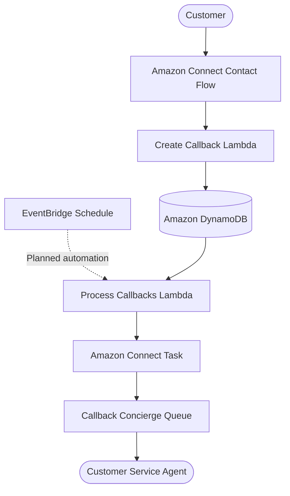

# Callback Concierge

A serverless callback management solution built with AWS, Amazon Connect, Terraform, and Python.

[](https://www.python.org/)
[](https://aws.amazon.com/)
[](https://developer.hashicorp.com/terraform)
[](#testing)

## Overview

Callback Concierge is a serverless customer service solution that allows callers to request a callback instead of waiting in a queue.

The solution uses Amazon Connect to interact with callers, AWS Lambda to process callback requests, and Amazon DynamoDB to store callback information. A separate processing Lambda creates Amazon Connect tasks for eligible callback requests, allowing customer service agents to follow up.

The project also includes infrastructure automation using Terraform, automated unit tests, and plans for a supervisor-facing REST API implemented using AWS CDK.

This project demonstrates practical experience with serverless architecture, Infrastructure as Code (IaC), event-driven processing, cloud permissions, automated testing, and contact centre integration.

## Key Features

- **Interactive contact flow:** Callers can select a callback reason using Amazon Connect.
- **Callback request management:** Lambda validates and stores callback details in DynamoDB.
- **Asynchronous processing:** A separate Lambda processes eligible pending callback requests.
- **Agent task creation:** Amazon Connect tasks are created and routed to the Callback Concierge Queue.
- **Duplicate-processing protection:** Conditional DynamoDB updates help prevent concurrent executions from claiming the same callback.
- **Eligibility controls:** The processor skips callbacks that are not explicitly marked as eligible.
- **Infrastructure as Code:** Terraform provisions and manages the core AWS resources.
- **Automated testing:** Pytest unit tests validate callback creation and processing behaviour.
- **Supervisor API:** A planned REST API will provide supervisors with visibility into callback requests.
- **Operational visibility:** Structured Lambda logging supports troubleshooting and monitoring.

## Architecture

### High-level architecture



**Architecture note:** The callback contact flow, DynamoDB integration, processing Lambda, and Amazon Connect task creation have been implemented and tested. The recurring EventBridge schedule is not yet enabled. The supervisor API and CDK implementation are planned project work.

### Technology stack

| Technology | Purpose |
|---|---|
| Amazon Connect | Contact flows and task-based callback handling |
| AWS Lambda | Callback creation and processing logic |
| Amazon DynamoDB | Persistent callback request storage |
| Amazon API Gateway | Planned supervisor REST API |
| Amazon EventBridge | Planned scheduled callback processing |
| AWS IAM | Permissions between AWS services |
| Amazon CloudWatch | Logs, metrics, and planned alarms |
| Terraform | Core infrastructure provisioning |
| AWS CDK | Planned supervisor API infrastructure |
| Python | Lambda implementation and unit tests |
| pytest | Automated unit testing |
| Git and GitHub | Version control and project collaboration |

## How It Works

### 1. Customer requests a callback

A customer calls the Amazon Connect phone number and follows the contact flow prompts. The customer selects a reason for the callback, such as billing or technical support.

### 2. Callback request is created

The `create_callback` Lambda receives the request, validates the required information, and saves a record in DynamoDB.

A callback record contains fields such as:

- `callbackId` — unique identifier for the request.
- `phoneNumber` — customer phone number.
- `reason` — reason for the callback.
- `status` — current processing status.
- `createdAt` and `updatedAt` — timestamps.
- `attempts` — processing attempt counter.

### 3. Callback is checked for eligibility

The `process_callbacks` Lambda queries pending callback requests and checks whether each request has `processingEligible` set to `true`.

Callbacks without this explicit eligibility flag are skipped. This safeguard prevents older records from being processed accidentally while the workflow is being developed.

### 4. Amazon Connect task is created

For an eligible callback, the processing Lambda claims the record using a conditional DynamoDB update and requests an Amazon Connect task.

The task contains the callback reason, customer phone number, and callback identifier. The configured task contact flow routes the task to the **Callback Concierge Queue**.

When successful, the callback record is updated to `CONTACT_CREATED` and stores the Amazon Connect contact ID.

### 5. Agent follows up

A customer service agent can handle the task through the Amazon Connect workflow and use the supplied details to follow up with the customer.

**Note:** Creating a task does not itself confirm that the customer has been called. The actual return call must be made by an agent or a separately configured outbound calling workflow.

## Callback Lifecycle

The principal statuses used by the implementation include:

| Status | Meaning |
|---|---|
| `PENDING` | Callback request is awaiting processing. |
| `PROCESSING` | The processor has claimed the callback. |
| `CONTACT_CREATED` | The Amazon Connect task was created successfully. |
| `FAILED` | The processor encountered a failure that it recorded. |

Callbacks that are ineligible or have already been claimed are skipped by the processor rather than processed again during that execution.

## Project Structure

```text
callback-concierge/
├── terraform/
│   ├── main.tf
│   ├── lambda.tf
│   ├── dynamodb.tf
│   └── ...
├── lambda/
│   ├── create_callback/
│   │   └── handler.py
│   └── process_callbacks/
│       ├── handler.py
│       └── function.zip
├── tests/
│   ├── test_create_callback.py
│   └── test_process_callbacks.py
├── cdk/
│   └── ...
├── docs/
│   └── ...
├── README.md
├── HANDOVER.md
└── .gitignore
```

*The tree illustrates the intended project organisation. Some directories and files may be added as the CDK implementation and documentation are completed.*

## Prerequisites

Before running the project locally, ensure you have:

- Python 3.13 or a compatible version.
- AWS CLI configured for an authorised AWS account.
- Terraform installed.
- Node.js and npm for the AWS CDK work.
- Access to the relevant AWS services and permissions.
- An Amazon Connect instance, configured contact flow, task flow, and queue.
- An AWS account and region in which the required resources can be deployed.

Do not commit AWS credentials, access keys, account-specific secrets, or sensitive customer data to the repository.

## Local Development

### 1. Clone the repository

```bash
git clone https://github.com/JaydenPillay16/callback-concierge.git
cd callback-concierge
```

### 2. Create and activate a virtual environment

Windows PowerShell:

```powershell
python -m venv .venv
.\.venv\Scripts\Activate.ps1
```

### 3. Install Python dependencies

Install the dependencies listed in the project's dependency file, if present. For a minimal test environment:

```powershell
python -m pip install boto3 pytest
```

### 4. Run the unit tests

```powershell
python -m pytest -v
```

The latest recorded test run completed with **8 passing tests**. Run the suite again after making changes to confirm the current result.

## Infrastructure Deployment

The core infrastructure is managed using Terraform.

From the Terraform directory:

```powershell
cd terraform
terraform init
terraform validate
terraform plan
```

Review the plan carefully before applying any changes.

```powershell
terraform apply
```

Only apply changes when the target AWS account, region, resource names, and planned modifications have been verified.

### Infrastructure management notes

- Terraform manages the core callback infrastructure.
- The Lambda functions require the correct environment variables, IAM permissions, and deployment packages.
- Amazon Connect resources must be configured with the correct instance, contact flow, queue, and region identifiers.
- Amazon Connect and the core Lambda/DynamoDB infrastructure may reside in different AWS regions; the configuration must account for this.
- Remote Terraform state and state locking should be configured before collaborating on or routinely deploying the infrastructure.
- Review the deployment plan before changing resources in a shared AWS environment.

See [HANDOVER.md](HANDOVER.md) for the current implementation state and operational considerations.

## Testing

Unit tests are located in the `tests/` directory.

The current suite covers callback creation and callback processing, including:

- Successful callback creation.
- Validation of missing required callback details.
- Handling an Amazon Connect callback request.
- Successful processing and task creation.
- Handling callback processing failures.
- Skipping callbacks that are not eligible for processing.

Run the tests with:

```powershell
python -m pytest -v
```

The unit tests use mocks for AWS service interactions where appropriate. Passing unit tests does not replace end-to-end testing against a real Amazon Connect instance.

## Security and Reliability

The project incorporates several safeguards:

- **Least-privilege IAM:** Service roles should have only the permissions required for their functions.
- **Conditional updates:** DynamoDB conditions protect callback claiming and status transitions.
- **Eligibility checks:** The processor requires explicit eligibility when `PROCESS_ELIGIBLE_ONLY=true`.
- **Input validation:** Required callback information is validated before storing a request.
- **Structured logging:** Processing outcomes are logged to support debugging and operational visibility.
- **Encryption:** DynamoDB encryption at rest and point-in-time recovery are configured in Terraform.
- **Controlled deployment:** Terraform plans should be reviewed before changes are applied.

Production readiness will require further work around retries, recovery of callbacks left in `PROCESSING`, failure handling after a task is created, monitoring, and end-to-end verification.

## Current Implementation Status

| Component | Status |
|---|---|
| Terraform core infrastructure | Implemented |
| DynamoDB callback storage | Implemented |
| Create Callback Lambda | Implemented and tested |
| Amazon Connect inbound callback flow | Configured and live-tested |
| Process Callbacks Lambda | Implemented and deployed |
| Amazon Connect task creation | Successfully tested |
| Eligibility protection | Implemented and deployed |
| Unit tests | 8 tests passing in the latest recorded run |
| EventBridge recurring schedule | Not yet enabled |
| Supervisor `GET /callbacks` API | Planned |
| AWS CDK supervisor API | Planned |
| CloudWatch alarms and final operational dashboard | Planned |
| Final handover and end-to-end validation | In progress |

## Roadmap

- [ ] Complete eligibility handling for newly created callback requests.
- [ ] Implement and verify scheduled processing with Amazon EventBridge.
- [ ] Test failure recovery and idempotency under repeated execution.
- [ ] Implement the supervisor-facing `GET /callbacks` API.
- [ ] Rebuild the supervisor API infrastructure using AWS CDK.
- [ ] Add CloudWatch alarms and useful operational metrics.
- [ ] Expand unit and integration test coverage.
- [ ] Complete the architecture documentation and operational handover.

## Learning Outcomes

This project provides practical experience with:

- Designing serverless AWS architectures.
- Integrating Amazon Connect with Lambda and DynamoDB.
- Building and managing infrastructure using Terraform.
- Using AWS IAM to control service access.
- Implementing conditional state transitions and processing safeguards.
- Writing and running Python unit tests.
- Preparing an AWS solution for monitoring, automation, and handover.

## Repository

[GitHub — Callback Concierge](https://github.com/JaydenPillay16/callback-concierge)

---

*Callback Concierge is an ongoing engineering project. Implementation status and deployment instructions should be updated as components are completed and verified.*
